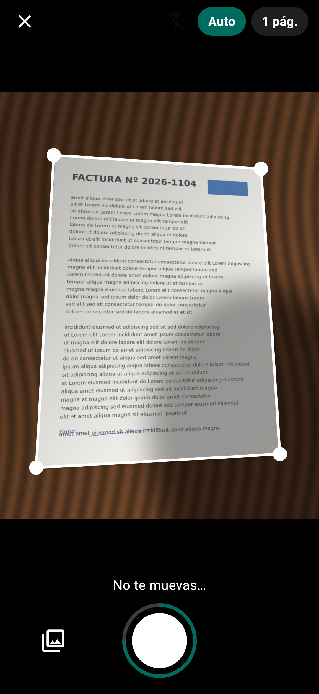
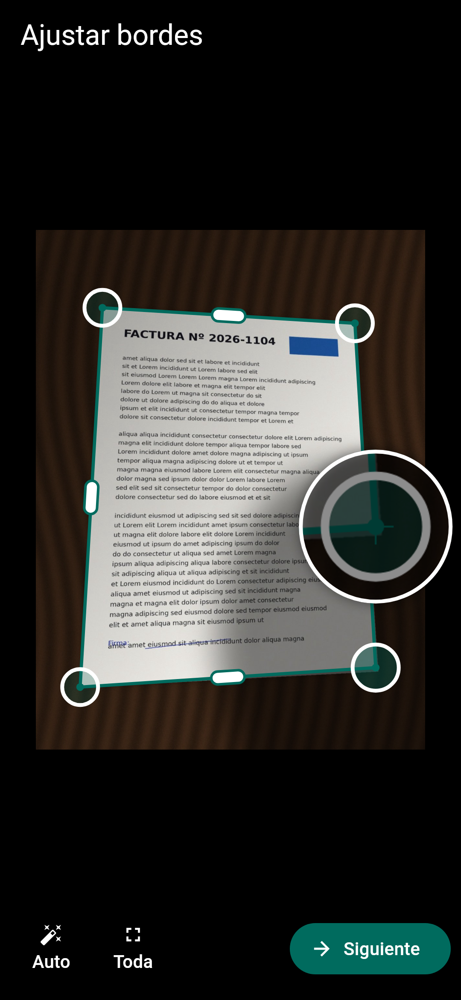
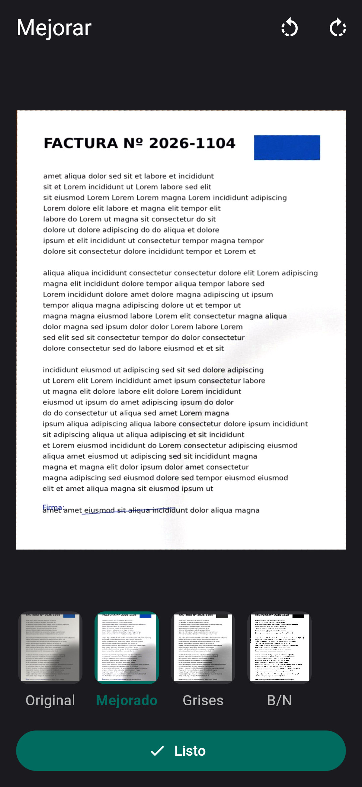
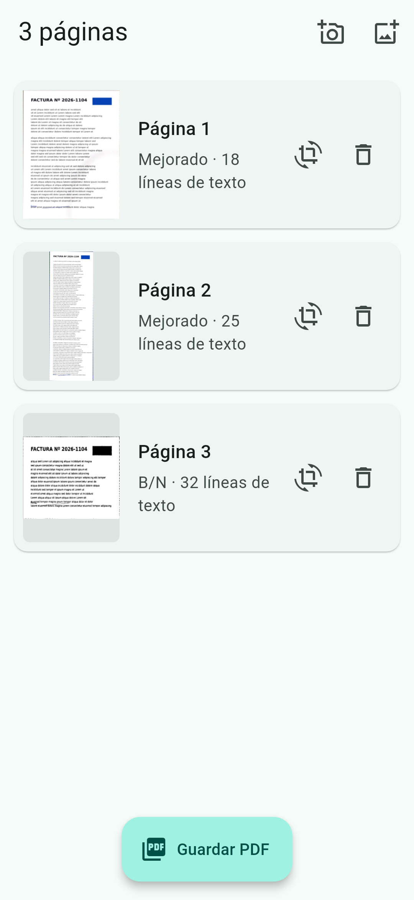
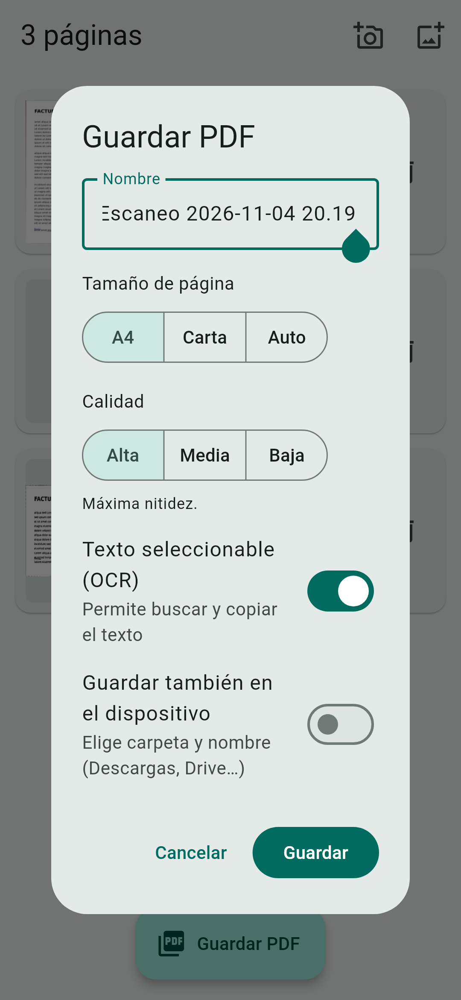
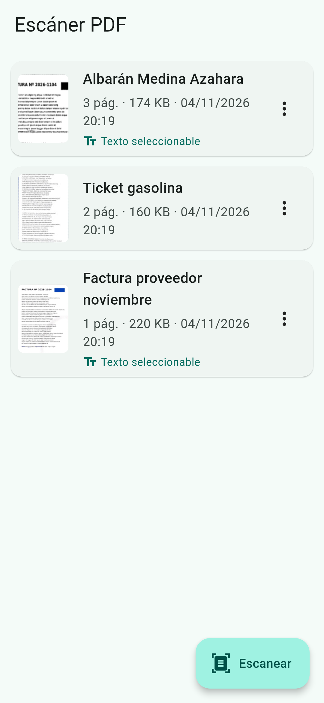

# Escáner PDF

App móvil (Android e iOS, Flutter) para **convertir fotos de documentos en PDF**,
al estilo CamScanner:

- 📷 **Cámara con detección en vivo**: el contorno del documento se dibuja sobre la vista
  previa y la foto se dispara sola cuando está quieto. Modo **lote** para escanear varias
  páginas seguidas, flash/linterna y enfoque tocando la pantalla. También desde la **galería**.
- ✂️ **Detección automática de bordes** y recorte, con ajuste manual de esquinas (lupa de precisión).
- 📐 **Corrección de perspectiva** con la relación de aspecto real del papel (A4, tickets…).
- ✨ **Mejora de legibilidad**: elimina sombras, blanquea el papel y realza el texto.
  Filtros: *Original*, *Mejorado* (color), *Grises* y *B/N*.
- 🔎 **OCR: texto seleccionable y buscable** en el PDF (capa de texto invisible sobre la
  imagen, como los escáneres profesionales). También se puede copiar todo el texto desde la app.
- 📄 Documentos de varias páginas (reordenar, editar, borrar) → PDF en A4, Carta o *Auto*.
- 💾 **Guardar en el dispositivo eligiendo carpeta y nombre** (Descargas, Documentos, tarjeta SD,
  Google Drive, iCloud…) con el selector del sistema, sin pedir permisos de almacenamiento.
  Calidad del PDF configurable (*Alta*, *Media*, *Baja*) para controlar el tamaño.
- 📂 Lista de PDFs guardados: abrir, compartir (WhatsApp, correo, Drive…), imprimir, guardar en
  una carpeta, renombrar, copiar texto y borrar. Las opciones elegidas se recuerdan.
- 🔒 Todo se procesa **en el propio móvil**: sin servidores, sin conexión y sin Google Play Services
  (el modelo de OCR de ML Kit va empaquetado en la app).

| Cámara en vivo* | Recorte | Filtros | Páginas | Guardar | Documentos |
|---|---|---|---|---|---|
|  |  |  |  |  |  |

\* Captura generada sin dispositivo: la vista previa es una foto fija de ejemplo, pero el
contorno y los controles son los reales de la app (mismo detector).

---

## 1. Instalar el APK sin compilar nada (Android)

Cada `push` a GitHub lanza el workflow [`.github/workflows/build.yml`](.github/workflows/build.yml),
que analiza el código, ejecuta los tests y compila el APK:

1. GitHub → pestaña **Actions** → último run de **Build APK**.
2. Abajo, en **Artifacts**, descarga `escaner-pdf-apk` (es un .zip con el `.apk`).
3. Pásalo al móvil y ábrelo (Android pedirá permitir "instalar apps desconocidas").

### Releases

Las versiones publicadas están en **Releases** (columna derecha del repositorio), con el
APK listo para descargar. Para publicar una nueva:

**Desde GitHub (también desde el móvil):** pestaña **Actions → Build APK → Run workflow**,
elige la rama, escribe la versión (p. ej. `1.0.0`) en *Versión a publicar como Release* y
pulsa **Run workflow**. GitHub crea el tag `v1.0.0`, compila el APK y publica la Release.

**Desde la terminal:**

```bash
git tag -a v1.1.0 -m "Escáner PDF 1.1.0"
git push origin v1.1.0
```

En ambos casos el APK lleva esa versión (`versionName` = `1.1.0`, `versionCode` = nº de
ejecución de CI, que siempre crece) y la Release incluye notas de instalación y los cambios
generados a partir de los commits.

Todas las builds se firman con la misma clave (sección 4), así que cada versión nueva
**se instala encima de la anterior sin perder los documentos**. Enlace fijo a la última:
https://github.com/JoseLuixrax/CameraScanner/releases/latest/download/EscanerPDF.apk

## 2. Compilar en local

Requisitos: [Flutter 3.47+](https://docs.flutter.dev/get-started/install) (Dart 3.13),
Android Studio / Android SDK (y Xcode en macOS para iOS).

```bash
git clone https://github.com/JoseLuixrax/CameraScanner.git
cd CameraScanner
flutter pub get

flutter run                      # móvil conectado por USB / emulador (debug)
flutter build apk --release      # build/app/outputs/flutter-apk/app-release.apk
flutter build appbundle          # .aab para Google Play
```

### iOS

```bash
cd ios && pod install && cd ..
open ios/Runner.xcworkspace      # Xcode → Signing & Capabilities → elige tu equipo
flutter run --release            # con el iPhone conectado
```

Los textos de permisos de cámara y fotos ya están en `ios/Runner/Info.plist`.
Requiere **iOS 15.5 o superior** (lo exige ML Kit para el OCR; ya configurado en
`ios/Podfile` y en el proyecto de Xcode).

## 3. Uso

1. **Escanear** → *Cámara* o *Galería*.
   - En la cámara, apunta al documento: el contorno aparece en blanco y se vuelve verde
     cuando está quieto. Con **Auto** activado la foto se hace sola (el anillo del disparador
     indica cuánto falta); si no, pulsa el disparador.
   - **Lote**: la cámara no se cierra tras cada foto; cambia de hoja y se dispara otra vez.
     Pulsa la miniatura (**Listo**) al terminar: las páginas se recortan y mejoran solas.
   - Icono de rayo: flash apagado / automático / linterna. Toca la imagen para enfocar.
2. **Ajustar bordes**: arrastra las esquinas (aparece una lupa) o el punto medio de un
   lado para moverlo entero. *Auto* vuelve a la detección automática, *Toda* usa la foto completa.
3. **Mejorar**: elige filtro (por defecto *Mejorado*) y gira si hace falta. Pellizca para hacer zoom.
4. Añade más páginas con los iconos de cámara/galería de arriba. Mantén pulsada una página
   para reordenarla; tócala para volver a recortarla o cambiar el filtro.
5. **Guardar PDF** → nombre, tamaño de página, calidad, *Texto seleccionable (OCR)* y
   *Guardar también en el dispositivo* → se abre el visor con *Guardar en el dispositivo*,
   *Copiar texto*, *Compartir* e *Imprimir*.

**Guardar en el dispositivo** abre el selector de archivos del sistema: eliges la carpeta
(Descargas, Documentos, una subcarpeta nueva, la tarjeta SD, Google Drive, iCloud Drive…) y el
nombre del archivo. El sistema recuerda la última carpeta usada. Los PDF siguen estando
también en la lista de la app.

El texto de cada página se reconoce en segundo plano en cuanto la página está lista (verás
"Mejorado · 24 líneas de texto"), así que guardar el PDF es casi instantáneo. El texto se
puede seleccionar y buscar al abrir el PDF en cualquier visor (Adobe, Chrome, Drive, Archivos
de iOS…) y copiar entero desde la app con **Copiar texto** (menú ⋮ de cada documento o en el visor).

Si eliges **varias imágenes** de la galería, se recortan y mejoran automáticamente en
lote; después puedes retocar cualquier página.

## 4. Firma del APK

Por defecto el APK se firma con una **clave fija incluida en el repositorio**
(`android/app/escaner-pdf.keystore`, alias `escaner`), igual en local que en CI. Así
cada versión se instala encima de la anterior sin perder los PDFs guardados.

> ⚠️ Al estar en un repositorio público, esa clave **no es secreta**: sirve para uso
> personal o interno (instalando los APK desde las Releases de este repo), pero no
> para Google Play. Cualquiera podría firmar un APK que Android aceptaría como
> actualización, así que instala sólo los APK de las Releases oficiales.

Para publicar en Google Play (o si quieres una clave privada), crea la tuya: si existe
`android/key.properties` se usa en lugar de la clave fija. Cambiar de clave obliga a
desinstalar una vez la app.

```bash
# 1) Crear la clave (una sola vez, guárdala bien: si se pierde no podrás actualizar la app)
keytool -genkey -v -keystore upload-keystore.jks -keyalg RSA -keysize 2048 \
        -validity 10000 -alias upload

# 2a) Build local: crea android/key.properties (está en .gitignore, NO se sube)
#     con storeFile, storePassword, keyAlias y keyPassword.

# 2b) GitHub Actions: añade estos secrets en Settings → Secrets and variables → Actions
base64 -w0 upload-keystore.jks   # → ANDROID_KEYSTORE_BASE64
#   ANDROID_KEYSTORE_PASSWORD, ANDROID_KEY_ALIAS (upload), ANDROID_KEY_PASSWORD
```

## 5. Cómo funciona el motor de escaneo

Todo el procesado está en `lib/processing/`, en **Dart puro** (sin OpenCV ni código
nativo), se ejecuta en *isolates* para no bloquear la interfaz y está cubierto por tests.

```
foto ─► decodificar (EXIF, máx. 3000 px) ─► detectar documento ─► [ajuste manual]
     ─► perspectiva ─► filtro ─► rotación ─► JPEG ─► PDF (JPEG incrustado sin recomprimir)
```

### Detección de bordes — `document_detector.dart`

1. Reduce a 512 px, suaviza y calcula gradientes Sobel en **R, G y B** quedándose con el
   canal de más contraste (detecta papel blanco sobre mesas claras de otro tono).
2. Genera cuadriláteros candidatos por tres vías:
   - **Hough** guiado por la orientación del gradiente → combinaciones de 2 rectas
     horizontales + 2 verticales (robusto a objetos que tocan el papel y esquinas tapadas).
   - **Canny** a varios umbrales → componentes conexas → envolvente convexa → cuadrilátero de área máxima.
   - **Segmentación por brillo** (Otsu).
3. Puntúa cada candidato por el % de perímetro que coincide con un borde real con la
   **orientación y polaridad** correctas, el **contraste de región** dentro/fuera (descarta
   líneas de texto) y la **nitidez** (descarta la sombra que proyecta el papel).
4. Refina los mejores ajustando cada lado por mínimos cuadrados (precisión sub-píxel).
5. Si una esquina queda fuera de la foto, la desliza por su lado hasta el borde.

### Cámara en vivo — `camera_screen.dart`

- Paquete oficial `camera`. La foto se hace a la **resolución máxima** del sensor.
- Cada frame se reduce a ~360 px leyendo sólo 1 de cada N píxeles directamente del YUV/BGRA
  (unos ms aunque el frame sea de 12 MP), se gira según la orientación del sensor y se
  analiza en un isolate con el detector en **modo rápido** (~60–75 ms en un PC; en un móvil
  de gama media ~3–6 detecciones por segundo).
- `DocumentTracker` suaviza el contorno entre frames y cuenta las detecciones "quietas";
  tras disparar no repite hasta que la hoja cambia (modo lote).
- En Android el stream es continuo (CameraX limita sola su resolución); en iOS los frames
  se piden de uno en uno para no copiar imágenes de 12 MP a 30 fps.
- Tras la foto se vuelve a detectar a resolución completa (más preciso) y se pasa al recorte.
- Si la cámara integrada falla, se ofrece la cámara del sistema (sin detección en vivo).

### Perspectiva — `perspective.dart`

Homografía de 4 puntos + interpolación bilineal (con reducción previa anti-aliasing).
El tamaño de salida usa el **modelo de cámara pinhole** (Zhang & He, *Whiteboard scanning
and image enhancement*) para recuperar la proporción real del papel: un A4 fotografiado
en ángulo sale con proporción 1:1,414 y no "estirado".

### OCR y PDF con texto — `ocr_service.dart` + `pdf_service.dart`

- **Google ML Kit Text Recognition** (alfabeto latino: español, francés, alemán, italiano,
  portugués, inglés…) en el dispositivo, sobre la imagen final ya recortada y mejorada.
  En Android se usa el modelo empaquetado (`com.google.mlkit:text-recognition`), no el de
  Play Services.
- Cada línea reconocida se escribe en el PDF con **modo de render invisible** (`3 Tr`) y
  escalada para ocupar exactamente su caja sobre la imagen: al seleccionar, el resaltado
  coincide con el texto que se ve.
- Fuente Helvetica estándar (no se incrusta, 0 bytes extra) con WinAnsiEncoding:
  á é í ó ú ñ ü ç ß œ € “ ” – … se copian correctamente.
- Se guarda además un `.txt` con el texto (para *Copiar texto*).

### Mejora de legibilidad — `enhance.dart`

- **Estimación del fondo** (iluminación del papel): máximo por bloques (elimina el texto),
  clasificación papel / contenido oscuro (fotos y recuadros de color no se "lavan"),
  inpainting y suavizado.
- **Mejorado**: divide por el fondo (sin sombras, papel blanco), balance de blancos global
  (quita el tono amarillento), máscara de enfoque y curva tonal que oscurece el texto.
- **Grises**: lo mismo sobre la luminancia.
- **B/N**: umbral adaptativo local (tipo Bradley) sobre la imagen normalizada.

## 6. Estructura

```
lib/
  main.dart                     tema y arranque
  models/                       ScanPage (página en edición), OcrLine (línea de texto)
  processing/                   motor (Dart puro, testeable sin móvil)
    geometry.dart               puntos, cuadriláteros, envolvente convexa, rectas
    image_ops.dart              RgbImage, redimensionado, blur, morfología, Otsu
    document_detector.dart      detección automática del documento
    perspective.dart            homografía, rectificación, relación de aspecto
    enhance.dart                filtros de mejora
    codec.dart                  JPEG/PNG/WebP… ↔ RgbImage (paquete image)
    pipeline.dart               funciones de alto nivel para isolates
    frame_converter.dart        frames de cámara (YUV420/NV21/BGRA) → imagen reducida
    document_tracker.dart       suavizado y estabilidad para el disparo automático
  services/
    image_service.dart          galería / cámara del sistema (image_picker) + isolates
    device_saver.dart           guardar en carpeta del dispositivo (selector del sistema)
    app_prefs.dart              preferencias recordadas (shared_preferences)
    ocr_service.dart            OCR en el dispositivo (Google ML Kit)
    pdf_service.dart            generación del PDF + capa de texto invisible
    document_repository.dart    PDFs guardados (almacenamiento interno de la app)
  screens/                      inicio, cámara en vivo, sesión, recorte, filtros, visor PDF
  widgets/                      editor de esquinas con lupa, diálogos
test/                           59 tests (geometría, perspectiva, detector, cámara, filtros, OCR, PDF…)
tool/scan_cli.dart              prueba el motor sobre una foto desde la terminal
tool/screenshots/               genera las capturas de docs/screenshots
docs/samples/                   fotos de ejemplo
```

## 7. Desarrollo

```bash
flutter analyze
flutter test

# Probar el motor con cualquier foto (genera recorte + 4 filtros en scan_out/)
dart run tool/scan_cli.dart docs/samples/factura_sombra.jpg scan_out

# Regenerar capturas de pantalla
flutter test --update-goldens tool/screenshots/screenshots_test.dart

# Regenerar iconos tras cambiar assets/icon/
dart run flutter_launcher_icons
```

## 8. Ideas para siguientes versiones

- Enviar el PDF a n8n/Odoo por webhook (p. ej. facturas de proveedor → contabilidad).
- PDF protegido con contraseña.
